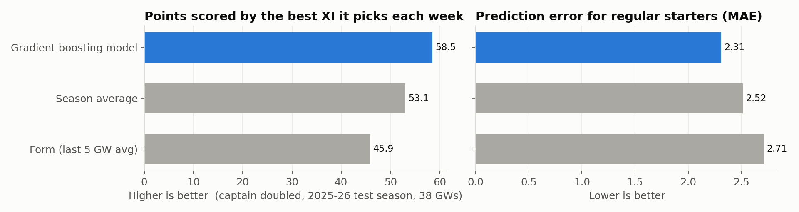
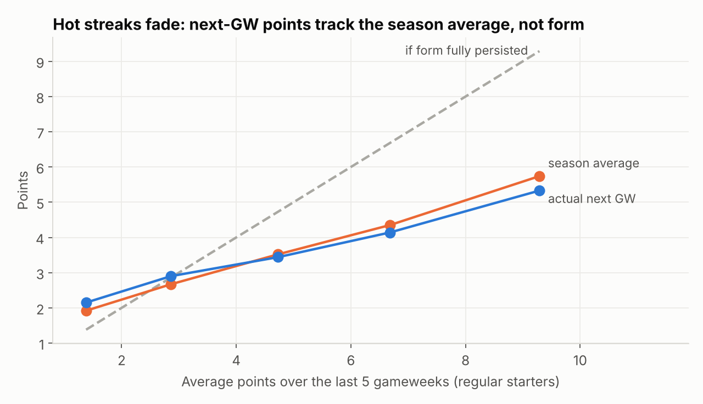
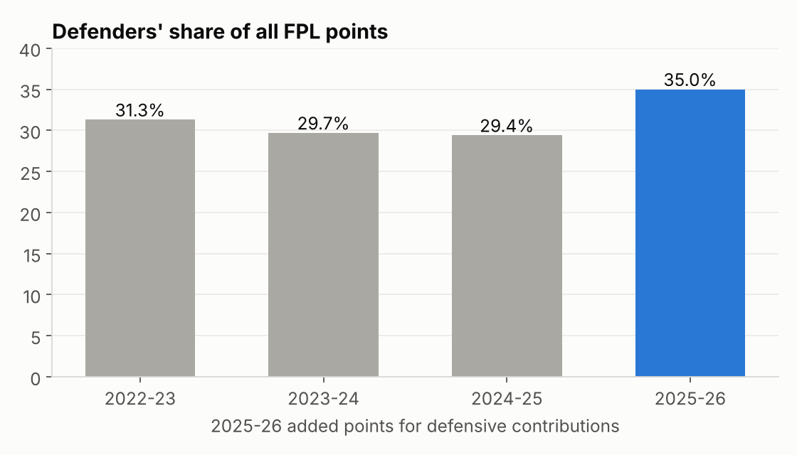
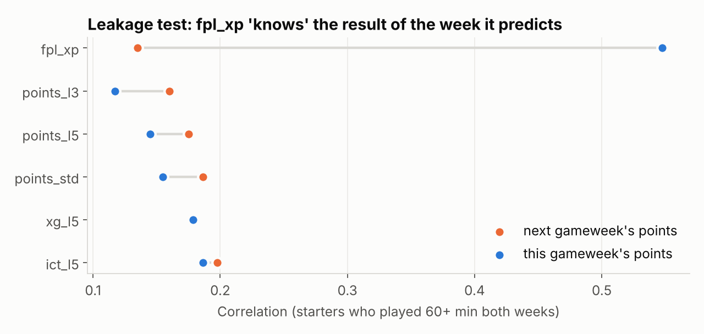
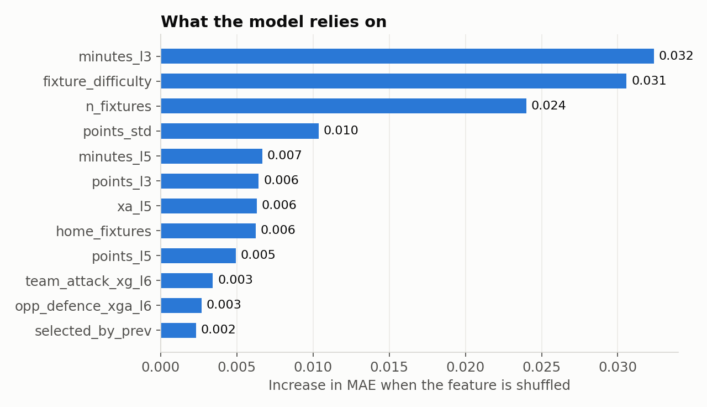

# FPL Points Lab

**Predicting Fantasy Premier League points with SQL feature engineering and gradient boosting, tested on a season the model never saw, and updated automatically every gameweek.**

[](https://github.com/andrewkwon0804-web/fpl-analyzer/actions/workflows/refresh.yml)
[](https://github.com/andrewkwon0804-web/fpl-analyzer/actions/workflows/ci.yml)

**[Website](https://andrewkwon0804-web.github.io/fpl-analyzer/)** · **[Model report](https://andrewkwon0804-web.github.io/fpl-analyzer/research.html)** · **[Dashboard](https://andrewkwon0804-web.github.io/fpl-analyzer/dashboard.html)** · **[50-second demo video](https://andrewkwon0804-web.github.io/fpl-analyzer/media/fpl-points-lab-demo.mp4)**

Python · SQL (SQLite, window functions, CTEs) · scikit-learn · pytest · GitHub Actions · React · three.js · Observable Plot · Tableau

> Andrew Kwon, B.S. Information Sciences @ UIUC. Follow-up to my earlier
> [FPL Analyzer](https://github.com/andrewkwon084/fpl-analyzer) (a React app with a hand-tuned value score).

## The short version

**Question.** Can a model predict next week's FPL points well enough to pick a better team than the rules most managers already use (a player's season average, or his last five games)?

**Approach.** 118,000 player-match rows from 2022-23 on, loaded into SQLite. 27 features built in SQL with window functions that always end the week before, so no row sees its own match (a test checks this). A gradient boosting model trained on two seasons, tuned on a third and scored once on a fourth. Uncertainty from a paired bootstrap over gameweeks, because players in the same week share fixtures and luck.

**Result.** On 2025-26, which the model never saw, its weekly best XI scored 6.9 more points a week than the season-average rule (95% interval +2.7 to +11.1), about 260 points over the season. Prediction error for regular starters fell 8%. The captain pick alone was *not* reliably better, and the report says so.

**What I found along the way.**
* Defenders were under-predicted by 0.52 points a week, because the training seasons predate the 2025-26 rule that pays defensive contributions. Telling the model about the rule fixed most of the bias but made the average error slightly worse. That isn't a contradiction: FPL scores are skewed (regular starters average 3.2 points, the typical score is 2), and the number with the smallest average error sits below the true average. I kept the fix, since picking defenders fairly matters more than 0.03 points of error ([`experiments/rule_era.py`](experiments/rule_era.py)).
* FPL's own expected-points column looks like the best predictor until you check it: it correlates 0.55 with the same week's points and 0.14 with the next week's, so it is filled in after the games. It's excluded ([`src/fpl/leakage.py`](src/fpl/leakage.py)).
* On ranking alone the model and the five-week form rule tie (0.710 vs 0.711 rank correlation). The model's lead comes from not picking players who then don't play: form's captain sat out 13% of weeks, the model's 3%.

**Running on its own.** A GitHub Actions workflow pulls the official FPL API every six hours, re-runs the weekly part of the pipeline, runs the tests and publishes the site. Before each deadline it saves that gameweek's picks to [`reports/ledger/`](reports/ledger/); after the games it scores them. The commit history is the proof that each pick was made before kickoff.

---

## Results at a glance

Trained on 2022-23 and 2023-24, tuned on 2024-25, and scored **once** on the full 2025-26 season (38 gameweeks, ~29k player-gameweeks).



Each week, every method picks its best XI (a valid FPL formation, captain's points doubled), and is scored on what those players actually did.

| Method (2025-26 test season) | MAE, regular starters | Best XI pts per GW | Captain pts per GW |
|---|---|---|---|
| **Gradient boosting model** | **2.31** | **59.8** | **6.6** |
| Season average to date | 2.52 | 53.0 | 6.2 |
| Form (last 5 GW average) | 2.71 | 45.6 | 4.1 |
| Perfect hindsight (ceiling) | — | 154.8 | 17.2 |

**Is the edge real?** Each gap below is the model's average edge, with a 95% range from a paired bootstrap that resamples the 38 gameweeks (`reports/model_significance.csv`).

| Model compared with | Prediction error (MAE) | Best XI points per GW | Captain points per GW |
|---|---|---|---|
| Season average | **0.20 lower** (0.15 to 0.25) | **+6.9** (+2.7 to +11.1) | +0.3 (−0.9 to +1.5), not significant |
| Form (last 5 GW) | **0.40 lower** (0.36 to 0.44) | **+14.2** (+9.7 to +19.0) | **+2.4** (+1.1 to +3.9) |

* The model's best XI outscored the season-average rule by about **260 points over the season**, and the gap is clearly not luck.
* The captain pick on its own is **not** reliably better than season average. One pick a week is too noisy to separate the two over 38 gameweeks, so it is reported here but not claimed as a win.
* Prediction error is 8% lower than the best simple rule and 15% lower than picking by form.

## Explore it

* **[Website](https://andrewkwon0804-web.github.io/fpl-analyzer/)**: a home page with this week's picks and the model's track record, plus a dashboard with the best XI, players downgraded for injury news, every player's prediction with filters, each player's predictions vs points this season, the track record so far, and four analyses built in SQL ([`sql/site/`](sql/site/)): value for money by price tier, whether finishing above xG lasts, how much fixture difficulty matters (with every team's next five fixtures), and whether following transfer trends pays. A **transfer planner** takes your 15-man squad, bank, free transfers and remaining chips, and plans the next five gameweeks: when to use or roll each free transfer, whether a -4 hit pays, who to captain each week and when to play each chip. It searches week by week (a beam search in a Web Worker) within the budget and three-per-club rule, and a squad can be shared as a link. The home page explains the pipeline as a 3D stack you can turn and open (three.js), with the track record drawn as you scroll. Built with React and Vite in [`web/`](web/) into [`docs/`](docs/), served by GitHub Pages and fed by one JSON file that [`src/fpl/export_site.py`](src/fpl/export_site.py) writes. An older Streamlit version is in [`app/streamlit_app.py`](app/streamlit_app.py).
* **[Model report](https://andrewkwon0804-web.github.io/fpl-analyzer/research.html)**: how the model did on 2025-26, a season it never trained on. Results against two simple baselines with 95% bootstrap intervals, the whole season replayed as best-XI picks, rank correlation by week and by how far ahead, calibration by position, lift by decile, a prediction-range explorer, residuals, error slices, permutation importance and the leakage check. Charts are [Observable Plot](https://observablehq.com/plot/); each figure has a table view and a CSV download. Its data comes from [`src/fpl/export_research.py`](src/fpl/export_research.py).
* **SQL lab** (on the model report): a trimmed copy of the SQLite database (6 tables, 5.6 MB gzipped) runs in the browser through [sql.js](https://sql.js.org/) in a Web Worker, with a CodeMirror editor that autocompletes table and column names. The queries below load as presets; results show as a sortable table or a chart.
* **The home page's two set pieces**, both drawn from the week's data: the league as a match ball (20 club hexagons raised by predicted points, ringed in the colour of the next fixture) that breaks apart on scroll into a ranking of the clubs, and every player in a 3D price-against-points market with each position's value line.
* **One of the model's trees** on the model report: the first of its 143 trees, exported from scikit-learn ([`src/fpl/export_tree.py`](src/fpl/export_tree.py)), with real 2025-26 player-weeks falling through the same splits the model uses.
* **Prediction ledger**: picks saved before every deadline since 2026-27 gameweek 10 and scored after the games ([`src/fpl/ledger.py`](src/fpl/ledger.py)), shown on the home page as "Called before kickoff".
* **Tableau dashboards**: model scorecard, value finder and team attack vs defence, in [`tableau/FPL Points Lab.twbx`](tableau/). The workbook is generated from the CSV extracts by [`tableau/build_workbook.py`](tableau/build_workbook.py).

## This season (2026-27)

The pipeline also follows the season in progress. Each run re-downloads it, retrains the model on all four finished seasons, scores it on the gameweeks played so far, and predicts the next gameweek.

**A second unseen test, gameweeks 1-7.** Prediction error for regular starters is 2.34 against 2.90 for the season-average rule, 0.54 lower (95% range 0.33 to 0.80): a clear edge in a season the model has never seen. The best-XI gap (+16.3 points per gameweek, range -7.7 to +43.3) can't be called yet after seven weeks.

**Live picks.** The [website](https://andrewkwon0804-web.github.io/fpl-analyzer/) opens on the next gameweek: the predicted best XI, the captain, and the top picks by position and price. Live features are computed in [`sql/upcoming.sql`](sql/upcoming.sql). A test replays the season (hides the last played gameweek and rebuilds them) and checks they match the training features exactly, so live picks use the same inputs the model learned from. Players FPL has flagged are scaled by their chance of playing, which the model can't see on its own.

**Five weeks ahead.** [`sql/horizon.sql`](sql/horizon.sql) builds the same features for each of the next six gameweeks, swapping in each week's own fixture, and the planner uses them. A backtest on 2025-26 ([`experiments/horizon_backtest.py`](experiments/horizon_backtest.py)) shows accuracy fades slowly with distance:

| Weeks ahead | 1 | 2 | 3 | 4 | 5 |
|---|---|---|---|---|---|
| Rank correlation per gameweek | 0.71 | 0.68 | 0.66 | 0.65 | 0.64 |
| MAE, regular starters | 2.31 | 2.35 | 2.35 | 2.35 | 2.37 |

To refresh during the season: `python run_pipeline.py`, then commit `reports/live/` and `docs/`. After changing the site's code, rebuild it with `cd web && npm install && npm run build`.

## The model's FPL team

[`src/fpl/model_team.py`](src/fpl/model_team.py) runs a simulated FPL team under the real rules: a £100m squad of 15 (two keepers, five defenders, five midfielders, three forwards, at most three per club) picked with integer programming in PuLP, the best XI and captain by predicted points each week, one free transfer a week that rolls over up to five, -4 for each extra, FPL's selling-price rule, auto-subs and the vice-captain. A transfer has to add at least a point of predicted value, so the team doesn't churn on noise. Gameweeks already played use the predictions the model made before each deadline; from now on each week's decision is saved in `reports/live/model_team_log.json` before the gameweek starts and never redone. The dashboard's Model team tab tracks it against the average FPL manager.

**News the flags miss.** FPL's chance-of-playing flag only covers injuries and suspensions. [`data/news_overrides.csv`](data/news_overrides.csv) takes anything else (a dispute with the manager, reported rotation): one row per player with a chance of playing, a note and the last gameweek it applies to. Predictions use the lower of the two chances.

## What didn't work

Early in 2026-27 the model rated Brighton's in-form players below names like Thiago and Mbeumo, which looked like it trusted last season too much. The experiments in [`experiments/`](experiments/) tested that:

* **Is it biased against breakout players?** No. Regular starters averaging far more than last season (6.4 points a week against 3.3) scored 3.46 the following week; the model predicted 3.50. Players far below last season scored 2.79 against a prediction of 2.78. Hot and cold streaks regress, and the model already accounts for it ([`breakout_bias.py`](experiments/breakout_bias.py)).
* **More features.** Twelve candidates, all built in SQL with the same no-leakage windows: defensive contributions (the 2025-26 rule), points and xGI per 90, bonus and starts per game, and each team's season-long attack, defence and clean-sheet rate. On the 2025-26 test, error for regular starters went from 2.311 to 2.315; on 2026-27 so far, from 2.343 to 2.368. Neither change is outside the noise, so the model keeps its original inputs ([`feature_sets.py`](experiments/feature_sets.py)). The columns stay in the database for when a second season of defensive-contribution data exists.
* **Weighting recent seasons more** (2025-26 counted two or three times) moved this season's error by 0.002 and the best-XI points by +2 per gameweek, with a 95% range of -4 to +8. Not enough to adopt ([`season_weights.py`](experiments/season_weights.py)).

## Four findings

**1. Form is mostly noise.** Starters who averaged 9+ points over their last five gameweeks scored 5.3 the next week, almost exactly their season average (5.7), not their form. Picking by recent form is the worst of the strategies tested.



**2. Overperforming xG doesn't last.** The 13 players who beat their expected goals by 3+ in 2023-24 or 2024-25 (average +5.1 goals) were back to +0.3 the following season; 12 of 13 fell back. (`sql/analysis/05_xg_over_under_performers.sql`)

**3. The 2025-26 rule change moved points to defenders.** The new defensive contribution rule lifted defenders from 29% to 35% of all points scored, and they're at 35.5% so far in 2026-27. The model was trained before the rule existed, and it under-predicts starting defenders by 0.5 points per gameweek in 2025-26, the largest bias of any position. Retraining with the new season fixes this going forward.



**4. The dataset's `xP` column leaks the answer.** The open dataset includes an expected-points column. A real pre-match forecast should correlate equally with *this* week's and *next* week's points. The model's features do; `xP` correlates **4x more** with the week it is supposed to predict, so it contains information from the match itself. Adding it to the model makes the scores look better, but that gain isn't real. It is excluded from training and shown only as a reference.



## What the model uses



Expected minutes matter most: a player who doesn't play scores nothing. Fixture difficulty and whether the gameweek is a double come next, then season-long scoring and underlying attacking output (xA).

## How it works

```
open FPL archive (CSV)                 SQLite: fpl.db
  merged_gw / teams /   ─ ingest.py ─▶  teams, players, fixtures, player_match
  fixtures / players       load_db.py            │
                                                  │ sql/features.sql (window functions)
                                                  ▼
                                    team_form ─▶ player_gw ─▶ player_features
                                                                   │
                         ┌──────────────────────┬──────────────────┼────────────────────┐
                         ▼                      ▼                  ▼                    ▼
                  sql/analysis/*.sql      leakage.py           model.py          export_tableau.py
                  business questions      input audit     time-split training    CSVs for Tableau
```

**Data.** Every player in every match from 2022-23 to the current 2026-27 season: about 117,000 player-match rows Finished seasons come from the community-maintained [vaastav/Fantasy-Premier-League](https://github.com/vaastav/Fantasy-Premier-League) archive of the official FPL API. The archive lags the live season, so 2026-27 comes straight from the official API ([`src/fpl/fetch_official.py`](src/fpl/fetch_official.py)); for the gameweeks both cover, every row matches. FPL only started publishing per-match xG in gameweek 16 of 2022-23; the archive stores the earlier weeks as 0, so the pipeline treats them as missing (a test checks this).

**Cleaning.** Dropped exact duplicate rows in the 2025-26 export, converted prices from tenths to £m, mapped team names to ids per season, excluded the one-season "assistant manager" chip, and summed double gameweeks into one row per player per gameweek.

**Features (all in SQL).** Rolling 3- and 5-gameweek averages of points, minutes, starts, xG, xA, xGC, bonus and ICT; season-to-date averages; last season's points per game (linked across seasons by FPL's stable `player_code`); opponent attack and defence strength from their last six matches' xG; FPL fixture difficulty, home fixtures, and number of fixtures in the gameweek. Every window ends at `1 PRECEDING`, so features only use information available before the deadline. `tests/test_pipeline.py` recomputes them independently in pandas to check this.

**Model.** `HistGradientBoostingRegressor` (scikit-learn), position as a categorical feature, early stopping. Small hyperparameter grid chosen on the 2024-25 validation season, then refit on 2022-25 and evaluated once on 2025-26.

**Evaluation.** MAE is reported for regular starters (60+ minutes recently) because most rows are bench players with 0 points, which makes every method look good. The decision metrics simulate how an FPL manager would use a forecast: pick a best XI and a captain each gameweek (`src/fpl/picks.py`), then score those picks by what actually happened. Ties between equal predictions are broken by player id, so results don't depend on sort order.

**Reproducibility.** Library versions are pinned in `requirements.txt`. Retraining on a different kind of processor (Apple Silicon vs Intel) changes a few tree splits through floating-point rounding: on Intel the best-XI edge over season average comes out at +5.5 instead of +6.9. Both runs reach the same conclusions. The numbers here come from Apple Silicon.

## SQL analysis

Questions answered in `sql/analysis/` (results in `reports/sql_results/`; all six run in the browser on the [model report](https://andrewkwon0804-web.github.io/fpl-analyzer/research.html#sql)):

| Query | Question |
|---|---|
| `01_value_by_price_band` | Are premium players worth the money? (points per £m by position and price) |
| `02_top_differentials` | Which players under 5% ownership scored the most each season? |
| `03_does_form_persist` | Does a hot streak predict next week? |
| `04_home_away_and_difficulty` | How much do venue and fixture difficulty move points? |
| `05_xg_over_under_performers` | Who beat their xG, and did it last? |
| `06_defcon_rule_change` | Did the 2025-26 rule change shift points between positions? |

Note on query 02: the data stores ownership as a raw count of managers, not a percentage. Every FPL squad has exactly 15 players, so `SUM(selected_by) / 15` for a gameweek recovers the total number of managers, and ownership % follows.

## Repository layout

```
run_pipeline.py          one command to rebuild everything (--refresh: the weekly update only)
src/fpl/                 ingest, load_db, run_sql, leakage, model, live, ledger, picks, report, exports
.github/workflows/       refresh.yml (scheduled data refresh), ci.yml (site build on every push)
reports/ledger/          picks saved before each deadline, and their scores
sql/schema.sql           relational schema with keys and constraints
sql/features.sql         feature engineering with window functions
sql/upcoming.sql         the same features for the next, unplayed gameweek
sql/horizon.sql          the same features for each of the next six gameweeks (transfer planner)
sql/site/                analysis queries behind the website's findings
experiments/             model experiments, including the ones that didn't help
web/                     the website's source (React, Vite, three.js, Observable Plot, sql.js)
docs/                    the built website (GitHub Pages)
sql/analysis/            standalone analysis queries
sql/tableau_exports.sql  flat views for Tableau
tests/                   pytest checks for duplicates, double gameweeks, missing xG, and leakage
app/                     Streamlit web app (reads the CSVs above)
reports/                 metrics, SQL results, figures
tableau/                 Tableau workbook, its generator script and CSV extracts
```

## Limitations and next steps

* **Injury news is applied after the model, not learned.** Live picks scale predictions by FPL's chance-of-playing flag, but the archive only keeps an end-of-season snapshot of that flag, so the model can't be trained or tested on it.
* **Rule change bias.** Defenders were under-predicted in 2025-26. A flag for seasons under the new rule fixes most of it in the live model, at a small cost in average error (see the short version above). The 2025-26 held-out test keeps the original inputs, since its training seasons all predate the rule.
* **Platform differences.** Gradient boosting on Linux and on macOS (Apple silicon) can differ in the last decimal places, which is enough to flip a close tuning choice. The held-out numbers above come from one fixed run; the scheduled refresh only re-runs the live part, with the tuned settings in `reports/best_params.json`.
* **`starts` is incomplete in 2022-23**, because FPL began tracking it mid-season. Minutes-based features carry most of the signal anyway.
* **Transfer search is a beam search, not an exact optimizer.** It keeps the best 10 plans each week, trying 1 to 3 transfers from each. An integer program (e.g. with PuLP) would guarantee the best multi-transfer plan.
* **Selling prices.** FPL sells a player for less than his current price if he rose after you bought him. The planner uses current prices, so the bank may need lowering by hand.

---
Data: [vaastav/Fantasy-Premier-League](https://github.com/vaastav/Fantasy-Premier-League) (MIT) and the official FPL API. Not affiliated with the Premier League or FPL.
