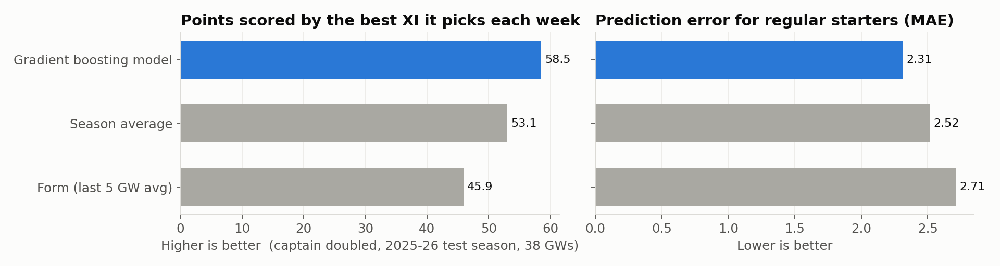
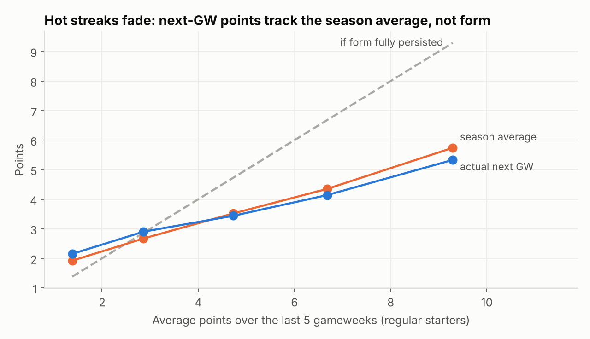
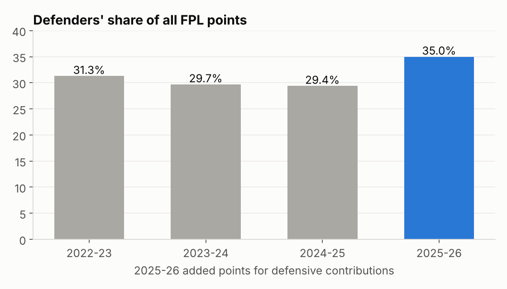
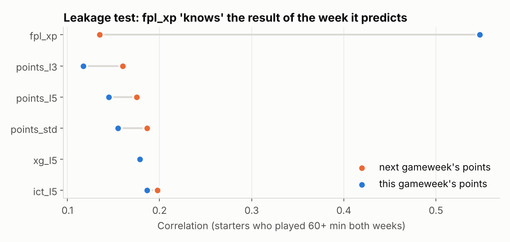
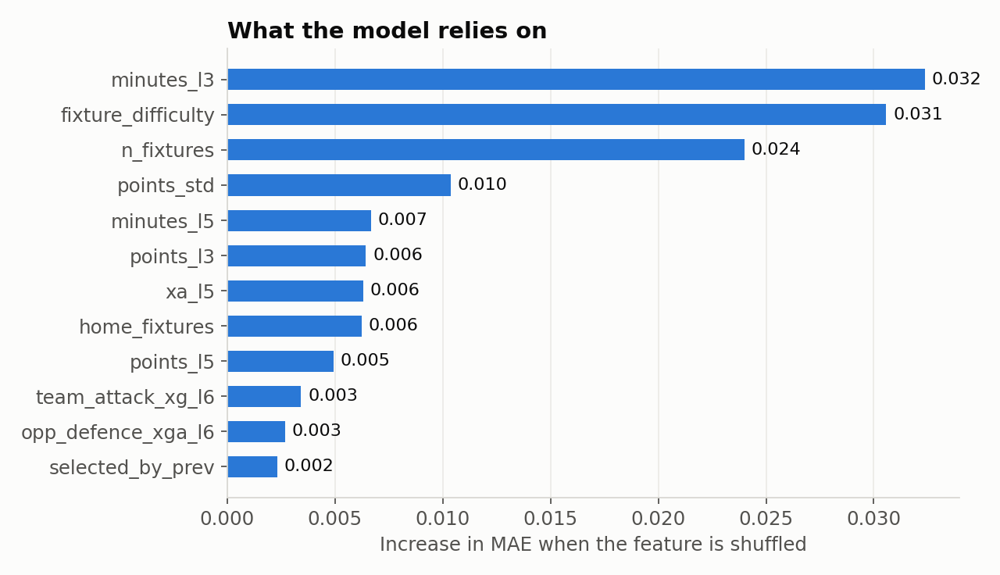

# FPL Points Lab

**Predicting Fantasy Premier League points with SQL feature engineering and gradient boosting, tested on a season the model never saw.**

**[Try the web app](https://fpl-points-lab.streamlit.app/)**

Python · SQL (SQLite, window functions, CTEs) · scikit-learn · Tableau · Streamlit · pytest

> Andrew Kwon, B.S. Information Sciences @ UIUC. Follow-up to my earlier
> [FPL Analyzer](https://github.com/andrewkwon084/fpl-analyzer) (a React app with a hand-tuned value score).

---

## Results at a glance

Trained on 2022-23 and 2023-24, tuned on 2024-25, and scored **once** on the full 2025-26 season (38 gameweeks, ~29k player-gameweeks).



Each week, every method picks its best XI (a valid FPL formation, captain's points doubled), and is scored on what those players actually did.

| Method (2025-26 test season) | MAE, regular starters | Best XI pts per GW | Captain pts per GW |
|---|---|---|---|
| **Gradient boosting model** | **2.31** | **59.8** | **6.6** |
| Season average to date | 2.52 | 53.0 | 6.2 |
| Form (last 5 GW average) | 2.71 | 45.6 | 4.1 |
| Perfect hindsight (ceiling) | — | 154.8 | 17.2 |

**Is the edge real?** Each gap below is the model's average edge, with a 95% range from a paired bootstrap that resamples the 38 gameweeks (`reports/model_significance.csv`).

| Model compared with | Prediction error (MAE) | Best XI points per GW | Captain points per GW |
|---|---|---|---|
| Season average | **0.20 lower** (0.15 to 0.25) | **+6.9** (+2.7 to +11.1) | +0.3 (−0.9 to +1.5), not significant |
| Form (last 5 GW) | **0.40 lower** (0.36 to 0.44) | **+14.2** (+9.7 to +19.0) | **+2.4** (+1.1 to +3.9) |

* The model's best XI outscored the season-average rule by about **260 points over the season**, and the gap is clearly not luck.
* The captain pick on its own is **not** reliably better than season average. One pick a week is too noisy to separate the two over 38 gameweeks, so it is reported here but not claimed as a win.
* Prediction error is 8% lower than the best simple rule and 15% lower than picking by form.

## Explore it

* **[Web app](https://fpl-points-lab.streamlit.app/)** (Streamlit): predictions for the next gameweek of the current season: the model's best XI and captain, players downgraded for injury news, top picks by position and price, each player's predictions vs points this season, and the model's track record so far. Source: [`app/streamlit_app.py`](app/streamlit_app.py).
* **Tableau dashboards**: model scorecard, value finder and team attack vs defence, in [`tableau/FPL Points Lab.twbx`](tableau/). The workbook is generated from the CSV extracts by [`tableau/build_workbook.py`](tableau/build_workbook.py).

## This season (2026-27)

The pipeline also follows the season in progress. Each run re-downloads it, retrains the model on all four finished seasons, scores it on the gameweeks played so far, and predicts the next gameweek.

**A second unseen test, gameweeks 1-6.** Prediction error for regular starters is 2.34 against 2.91 for the simple rule, 0.55 lower (95% range 0.29 to 0.87): a clear edge in a season the model has never seen. The best-XI gap (+18.7 points per gameweek, range -8.7 to +50.4) can't be called yet after six weeks. This early, "last 5 gameweeks" and "season average" are the same rule, so they're reported once.

**Live picks.** The [web app](https://fpl-points-lab.streamlit.app/) opens on the next gameweek: the predicted best XI, the captain, and the top picks by position and price. Live features are computed in [`sql/upcoming.sql`](sql/upcoming.sql). A test replays the season (hides the last played gameweek and rebuilds them) and checks they match the training features exactly, so live picks use the same inputs the model learned from. Players FPL has flagged are scaled by their chance of playing, which the model can't see on its own.

To refresh during the season: `python run_pipeline.py`, then commit `reports/live/`.

## Four findings

**1. Form is mostly noise.** Starters who averaged 9+ points over their last five gameweeks scored 5.3 the next week, almost exactly their season average (5.7), not their form. Picking by recent form is the worst of the strategies tested.



**2. Overperforming xG doesn't last.** The 13 players who beat their expected goals by 3+ in 2023-24 or 2024-25 (average +5.1 goals) were back to +0.3 the following season; 12 of 13 fell back. (`sql/analysis/05_xg_over_under_performers.sql`)

**3. The 2025-26 rule change moved points to defenders.** The new defensive contribution rule lifted defenders from 29% to 35% of all points scored, and they're at 35.5% so far in 2026-27. The model was trained before the rule existed, and it under-predicts starting defenders by 0.5 points per gameweek in 2025-26, the largest bias of any position. Retraining with the new season fixes this going forward.



**4. The dataset's `xP` column leaks the answer.** The open dataset includes an expected-points column. A real pre-match forecast should correlate equally with *this* week's and *next* week's points. The model's features do; `xP` correlates **4x more** with the week it is supposed to predict, so it contains information from the match itself. Adding it to the model makes the scores look better, but that gain isn't real. It is excluded from training and shown only as a reference.



## What the model uses



Expected minutes matter most: a player who doesn't play scores nothing. Fixture difficulty and whether the gameweek is a double come next, then season-long scoring and underlying attacking output (xA).

## How it works

```
open FPL archive (CSV)                 SQLite: fpl.db
  merged_gw / teams /   ─ ingest.py ─▶  teams, players, fixtures, player_match
  fixtures / players       load_db.py            │
                                                  │ sql/features.sql (window functions)
                                                  ▼
                                    team_form ─▶ player_gw ─▶ player_features
                                                                   │
                         ┌──────────────────────┬──────────────────┼────────────────────┐
                         ▼                      ▼                  ▼                    ▼
                  sql/analysis/*.sql      leakage.py           model.py          export_tableau.py
                  business questions      input audit     time-split training    CSVs for Tableau
```

**Data.** Every player in every match from 2022-23 to the current 2026-27 season: about 117,000 player-match rows from the community-maintained [vaastav/Fantasy-Premier-League](https://github.com/vaastav/Fantasy-Premier-League) archive of the official FPL API. FPL only started publishing per-match xG in gameweek 16 of 2022-23; the archive stores the earlier weeks as 0, so the pipeline treats them as missing (a test checks this).

**Cleaning.** Dropped exact duplicate rows in the 2025-26 export, converted prices from tenths to £m, mapped team names to ids per season, excluded the one-season "assistant manager" chip, and summed double gameweeks into one row per player per gameweek.

**Features (all in SQL).** Rolling 3- and 5-gameweek averages of points, minutes, starts, xG, xA, xGC, bonus and ICT; season-to-date averages; last season's points per game (linked across seasons by FPL's stable `player_code`); opponent attack and defence strength from their last six matches' xG; FPL fixture difficulty, home fixtures, and number of fixtures in the gameweek. Every window ends at `1 PRECEDING`, so features only use information available before the deadline. `tests/test_pipeline.py` recomputes them independently in pandas to check this.

**Model.** `HistGradientBoostingRegressor` (scikit-learn), position as a categorical feature, early stopping. Small hyperparameter grid chosen on the 2024-25 validation season, then refit on 2022-25 and evaluated once on 2025-26.

**Evaluation.** MAE is reported for regular starters (60+ minutes recently) because most rows are bench players with 0 points, which makes every method look good. The decision metrics simulate how an FPL manager would use a forecast: pick a best XI and a captain each gameweek (`src/fpl/picks.py`), then score those picks by what actually happened. Ties between equal predictions are broken by player id, so results don't depend on sort order.

**Reproducibility.** Library versions are pinned in `requirements.txt`. Retraining on a different kind of processor (Apple Silicon vs Intel) changes a few tree splits through floating-point rounding: on Intel the best-XI edge over season average comes out at +5.5 instead of +6.9. Both runs reach the same conclusions. The numbers here come from Apple Silicon.

## SQL analysis

Questions answered in `sql/analysis/` (results in `reports/sql_results/`):

| Query | Question |
|---|---|
| `01_value_by_price_band` | Are premium players worth the money? (points per £m by position and price) |
| `02_top_differentials` | Which players under 5% ownership scored the most each season? |
| `03_does_form_persist` | Does a hot streak predict next week? |
| `04_home_away_and_difficulty` | How much do venue and fixture difficulty move points? |
| `05_xg_over_under_performers` | Who beat their xG, and did it last? |
| `06_defcon_rule_change` | Did the 2025-26 rule change shift points between positions? |

Note on query 02: the data stores ownership as a raw count of managers, not a percentage. Every FPL squad has exactly 15 players, so `SUM(selected_by) / 15` for a gameweek recovers the total number of managers, and ownership % follows.

## Repository layout

```
run_pipeline.py          one command to rebuild everything
src/fpl/                 ingest, load_db, run_sql, leakage, model, live, picks, report, export_tableau
sql/schema.sql           relational schema with keys and constraints
sql/features.sql         feature engineering with window functions
sql/upcoming.sql         the same features for the next, unplayed gameweek
sql/analysis/            standalone analysis queries
sql/tableau_exports.sql  flat views for Tableau
tests/                   pytest checks for duplicates, double gameweeks, missing xG, and leakage
app/                     Streamlit web app (reads the CSVs above)
reports/                 metrics, SQL results, figures
tableau/                 Tableau workbook, its generator script and CSV extracts
```

## Limitations and next steps

* **Injury news is applied after the model, not learned.** Live picks scale predictions by FPL's chance-of-playing flag, but the archive only keeps an end-of-season snapshot of that flag, so the model can't be trained or tested on it.
* **Rule change bias.** Defenders are under-predicted in 2025-26; adding defensive-contribution features once a second season of that data exists should close the gap.
* **`starts` is incomplete in 2022-23**, because FPL began tracking it mid-season. Minutes-based features carry most of the signal anyway.
* **Squad optimization.** Turning predictions into a full 15-player squad under the £100m budget and three-per-club rule is a linear programming problem (e.g. with PuLP).

---
Data: [vaastav/Fantasy-Premier-League](https://github.com/vaastav/Fantasy-Premier-League) (MIT). Not affiliated with the Premier League or FPL.
